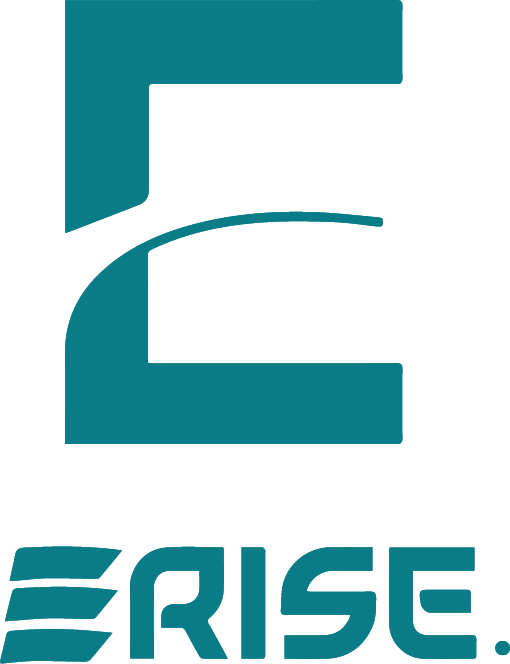

# E-RISE Meeting & Broadcasting Platform

  

A next-generation streaming and broadcasting meeting platform combining the community and channels ecosystem of **Discord** with the professional audio/video stage controls of **Google Meet**, built specifically for **E-RISE**.

---

## ✨ Features

- **Discord-like Ecosystem**:
  - Categorized voice and text channels (`#announcements`, `#general-discussions`, `#tech-architecture`, `🎙️ Main Stage`).
  - Account customization: Avatar photo, full name, custom status message.
  - Presence status selector: 🟢 **Online**, 🟡 **Asleep / Not Available**, 🔴 **Do Not Disturb**, ⚫ **Invisible/Offline**.
- **Google Meet-like Stage Controls**:
  - Floating controls dock: Mic, Camera, Screen Sharing, Raise Hand, In-meeting Chat, Participants Drawer.
  - Responsive multi-peer video grid with active speaker indication and screen share spotlight.
- **Granular Host Moderation**:
  - Remote mute / unmute for participants or "Mute All".
  - Force turn off participant camera or screen share.
  - Room lock / unlock to restrict access.
  - **Raise Hand Priority Queue**: Real-time notification and queue management so the host knows who wants to speak.
- **Configurable Room Capacity Limits**:
  - The meeting creator sets the participant cap (e.g. **10 persons max**).
  - Strict atomic enforcement at the database and WebSocket levels rejects the 11th user once capacity is reached.
- **Dual Backend Architecture**:
  - **Python 3.12 (FastAPI)**: WebRTC real-time signaling router and host moderation command dispatcher.
  - **Java 21 (Spring Boot)**: Meeting lifecycle, thread-safe participant quota validator, and Resend email dispatcher.
- **Channel Security & Encryption**:
  - Media streams encrypted end-to-end with **DTLS-SRTP** (AES-128/256).
  - WebSockets protected with WSS and token verification.
  - Input sanitization against XSS.
  - Database protected with Supabase Row Level Security (RLS).
- **Enterprise Integrations**:
  - **Supabase**: Authentication and PostgreSQL database.
  - **Resend**: Transactional account verification and meeting invites to `erise.club@hns-re2sd.dz`.
  - **Render**: Dockerized backend hosting.
  - **Firebase Hosting**: High-speed CDN hosting with custom domain support.

---

## 🚀 Quick Start

See [`DEPLOYMENT_GUIDE.md`](./DEPLOYMENT_GUIDE.md) for full instructions on local execution and cloud deployment.
